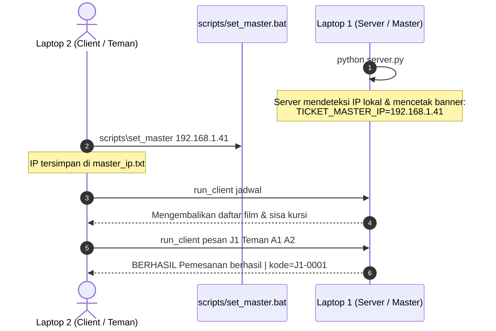

# Sistem Reservasi Tiket Bioskop Terdistribusi (gRPC)

[](https://www.python.org/)
[](https://grpc.io/)
[](https://protobuf.dev/)
[](https://docs.pytest.org/)

Proyek implementasi sistem reservasi tiket bioskop terdistribusi berbasis **gRPC + Protocol Buffers** untuk mata kuliah **Komputasi Paralel dan Terdistribusi**. Fokus utama proyek ini adalah menyelesaikan tantangan konkurensi: *beberapa client memesan kursi yang sama secara serentak (race condition)*, toleransi kegagalan jaringan (*network partition / timeout*), serta jaminan transaksi *at-most-once* (deduplikasi).

---

## Daftar Isi
1. [Arsitektur & Konsep Utama](#arsitektur--konsep-utama)
2. [Struktur Repositori](#struktur-repositori)
3. [Prasyarat & Instalasi](#prasyarat--instalasi)
4. [Kompilasi Protobuf](#kompilasi-protobuf)
5. [Panduan Menjalankan Sistem](#panduan-menjalankan-sistem)
   - [Skenario 1 Komputer (Lokal)](#skenario-1-komputer-lokal)
   - [Skenario 2 Laptop (Server & Client di LAN/Wi-Fi)](#skenario-2-laptop-server--client-di-lanwi-fi)
6. [Fitur Manajemen Admin](#fitur-manajemen-admin)
7. [Pengujian & Verifikasi Kinerja](#pengujian--verifikasi-kinerja)
   - [Test Suite Unit & Konkurensi](#test-suite-unit--konkurensi)
   - [Uji Beban Race Condition (Rebutan Kursi)](#uji-beban-race-condition-rebutan-kursi)
   - [Demo Toleransi Kegagalan (Timeout & Retry)](#demo-toleransi-kegagalan-timeout--retry)
   - [Benchmark Skalabilitas Komputasi Paralel](#benchmark-skalabilitas-komputasi-paralel)
8. [Desain Teknis & Concurrency Guard](#desain-teknis--concurrency-guard)
9. [Batasan Sistem](#batasan-sistem)

---

## Arsitektur & Konsep Utama

Sistem dirancang dengan pemisahan peran yang tegas antara lapisan komunikasi gRPC, model logika bisnis in-memory, dan layer persistensi data:

```
+-------------------------------------------------------------------------------+
|                             CLIENT / WORKER                                   |
|  - CLI Pemesan (klien_cli.py / run_client.bat)                                |
|  - Admin CLI Console (admin_cli.py)                                           |
|  - Exponential Backoff + Jitter Retry (klien.py)                              |
+-------------------------------------------------------------------------------+
                                      │  gRPC (HTTP/2 + Protobuf)
                                      ▼  Port 50051
+-------------------------------------------------------------------------------+
|                              SERVER (server.py)                               |
|  - ThreadPoolExecutor Worker Pool                                             |
|  - Logging Handler Terstruktur (Aturan 4.1)                                   |
|  - Dual Servicer Registration: LayananBioskop & LayananAdmin                  |
+-------------------------------------------------------------------------------+
                                      │
            ┌─────────────────────────┴─────────────────────────┐
            ▼                                                   ▼
+───────────────────────────────────+   +───────────────────────────────────────+
|     LOGIKA BISNIS (logika.py)     |   |          ADMIN (admin/)               |
| - Granular Lock per Jadwal Tayang |   | - Autentikasi (SHA-256 + Salt)        |
| - Check-Then-Act Protection       |   | - Token Session Management (1 Jam)    |
| - Idempotency Deduplication Cache |   | - Manajemen Jadwal & Rekapitulasi     |
| - Simulasi Beban Gateway Pembayaran|  | - Statistik Dashboard Terpadu         |
+───────────────────────────────────+   +───────────────────────────────────────+
            │
            ▼
+───────────────────────────────────+
|      PERSISTENSI (state.json)     |
| - Atomic write (tmp + os.replace) |
| - fsync durability jaminan restart|
+───────────────────────────────────+
```

---

## Struktur Repositori

```text
kpt-ticketing/
│
├── proto/                          # Definisi Protocol Buffers (IDL)
│   ├── bioskop.proto               # Layanan tiket (4 Unary RPC + 1 Server Streaming)
│   └── admin.proto                 # Layanan admin (auth, dashboard, kelola jadwal & pesanan)
│
├── admin/                          # Modular Package Layanan Admin
│   ├── __init__.py                 # Public API exports package admin
│   ├── auth.py                     # Autentikasi SHA-256 + Salt & manajemen token
│   ├── logika.py                   # Operasi CRUD jadwal, rekap pesanan, statistik
│   └── servicer.py                 # Implementasi gRPC LayananAdminServicer
│
├── scripts/                        # Skrip Pengujian, Benchmark & Otomasi
│   ├── bench.py                    # Benchmark skalabilitas paralel (1, 5, 20 worker)
│   ├── demo_retry.py               # Simulasi network delay, retry & deduplikasi
│   ├── eksperimen_lokal.py         # Perbandingan raw memory: DENGAN lock vs TANPA lock
│   ├── find_master.py              # Otomasi deteksi IP lokal antarmuka jaringan aktif
│   ├── run_race_local.py           # Eksekutor otomatis end-to-end race condition gRPC
│   ├── run_client.sh               # Wrapper CLI pendek (Linux / macOS)
│   ├── set_master.bat              # Helper konfigurasi IP master untuk laptop client
│   └── uji_race.py                 # Uji konkurensi gRPC (rebutan kursi tunggal & acak)
│
├── tests/                          # Test Suite Komprehensif (47 Test Cases)
│   ├── __init__.py
│   ├── test_admin.py               # Unit test autentikasi dan logika admin
│   └── test_logika.py              # Unit test atomisitas kursi, dedup, dan race condition
│
├── hasil/                          # Direktori Luaran Pengujian Otomatis
│   ├── benchmark_scaling.csv       # Data skalabilitas pemrosesan transaksi paralel
│   ├── grafik_scaling.png          # Visualisasi diagram batang waktu pemrosesan vs worker
│   ├── hasil_bench.csv             # Metrik lengkap throughput & latensi rata-rata / p95
│   ├── hasil_bench.png             # Kurva grafik perbandingan throughput & latensi
│   ├── uji_race.txt                # Bukti eksekusi uji race condition (SEMUA LULUS)
│   └── demo_retry.txt              # Bukti demo retry & deduplikasi (KONSISTEN)
│
├── laporan/                        # Naskah Laporan Resmi Proyek & Aset Diagram
│   ├── Laporan_ProyekRPC.pdf
│   ├── arsitektur.png
│   └── buat_laporan.py
│
├── server.py                       # Daemon Server gRPC Bioskop & Admin
├── logika.py                       # Core Engine: StoreBioskop thread-safe in-memory
├── klien.py                        # SDK Client: Timeout, retry logic, request_id
├── klien_cli.py                    # CLI Interaktif Client (Pemesanan & Peta Kursi)
├── admin_cli.py                    # CLI Interaktif Admin (Menu Konsol Terpadu)
├── run_tests.py                    # Test Runner Terpadu (Pytest & Unittest)
├── run_race_local.py               # Shortcut root runner uji race condition
├── run_client.bat                  # Wrapper CLI pendek (Windows Command Prompt)
├── run_client.ps1                  # Wrapper CLI pendek (Windows PowerShell)
├── generate_stubs.py               # Protobuf Compiler script (Cross-platform Python)
├── generate_stub.sh                # Protobuf Compiler script (Linux / macOS Shell)
├── requirements.txt                # Dependensi utama proyek
└── README.md                       # Dokumentasi resmi proyek
```

---

## Prasyarat & Instalasi

### Prasyarat Sistem
* Python 3.10 atau versi yang lebih baru (mendukung hingga Python 3.14).
* pip (Python package installer).
* Sistem Operasi: Windows 10/11, Ubuntu 20.04+, macOS Catalina+, atau distro Linux modern lainnya.

### 1. Kloning Repositori
```bash
git clone https://github.com/Raka-coder/kpt-ticketing.git
cd kpt-ticketing
```

### 2. Konfigurasi Virtual Environment

#### Pada Windows (PowerShell / CMD):
```powershell
python -m venv venv
.\venv\Scripts\activate
```

#### Pada Linux / macOS (Bash / Zsh):
```bash
python3 -m venv venv
source venv/bin/activate
```

### 3. Instalasi Dependensi
Instal seluruh pustaka yang dibutuhkan (gRPC, compiler tools, test runner, data analytics & visualization):
```bash
pip install -r requirements.txt
```

---

## Kompilasi Protobuf

Kompilasi kontrak antarmuka proto ke stub Python (`*_pb2.py` dan `*_pb2_grpc.py`).

#### Menggunakan Python Runner (Rekomendasi Windows & Linux):
```bash
python generate_stubs.py
```

#### Menggunakan Bash Script (Linux / macOS):
```bash
chmod +x generate_stub.sh scripts/run_client.sh
./generate_stub.sh
```

Perintah di atas akan menghasilkan:
* `bioskop_pb2.py` & `bioskop_pb2_grpc.py` (Layanan Pemesanan)
* `admin_pb2.py` & `admin_pb2_grpc.py` (Layanan Admin)

---

## Panduan Menjalankan Sistem

### Skenario 1 Komputer (Lokal)

Buka 2 tab terminal terpisah di direktori proyek:

#### Terminal 1 — Menjalankan Server
```bash
python server.py
```
*Opsi tambahan server:*
* `--port 50051` : Mengatur listening port (default: 50051).
* `--workers 32` : Mengatur worker thread pool gRPC.
* `--state-file state.json` : Mengaktifkan persistensi JSON tahan restart.
* `--simulasi-beban` : Mengaktifkan delay simulasi payment gateway eksternal (0.2s - 0.5s).

#### Terminal 2 — Menjalankan Klien CLI
```bash
# 1. Melihat jadwal tayang film
python klien_cli.py jadwal

# 2. Melihat peta denah kursi jadwal J1
python klien_cli.py peta J1

# 3. Memesan kursi (Jadwal: J1, Nama: Budi, Kursi: A1 dan A2)
python klien_cli.py pesan J1 Budi A1 A2

# 4. Mencoba memesan kursi yang sudah terisi (akan GAGAL atomik)
python klien_cli.py pesan J1 Andi A2

# 5. Membatalkan pesanan (Gunakan kode booking yang didapatkan)
python klien_cli.py batal J1-0001 Budi
```

#### Terminal 3 (Opsional) — Pemantauan Real-time (Server Streaming)
```bash
python klien_cli.py pantau J1
```
Terminal ini akan menerima siaran update perubahan status kursi secara langsung setiap ada pesanan baru atau pembatalan.

---

### Skenario 2 Laptop (Server & Client di LAN/Wi-Fi)

Sistem telah dilengkapi modul **auto-detect IP** dan **wrapper perintah singkat** sehingga tidak perlu mengetik alamat IP secara manual berulang kali.



#### Langkah di Laptop 1 (Server / Master):
1. Sambungkan laptop ke jaringan Wi-Fi / Hotspot bersama.
2. Jalankan server:
   ```bash
   python server.py
   ```
3. Server otomatis menampilkan banner:
   ```text
   2026-10-31 20:00:00,000 [INFO] TICKET_MASTER_IP=192.168.1.41
   2026-10-31 20:00:00,001 [INFO] Server bioskop berjalan di 192.168.1.41:50051 (workers=32...)
   ```
   *(Pastikan port 50051 diizinkan pada firewall Windows/Linux bila diperlukan)*.

#### Langkah di Laptop 2 (Client / Teman):
1. Hubungkan ke jaringan Wi-Fi / Hotspot yang sama dengan server.
2. Buka terminal proyek, lalu set IP server (cukup **satu kali saja**):
   - **Windows:**
     ```cmd
     scripts\set_master 192.168.1.41
     ```
   - **Linux / macOS:**
     ```bash
     echo "192.168.1.41" > master_ip.txt
     ```
3. Sekarang teman dapat menjalankan seluruh perintah dengan sangat ringkas:

| Perintah Windows | Perintah Linux / macOS | Deskripsi Aksi |
|---|---|---|
| `run_client jadwal` | `./scripts/run_client.sh jadwal` | Melihat daftar tayang bioskop |
| `run_client peta J1` | `./scripts/run_client.sh peta J1` | Melihat denah visual kursi J1 |
| `run_client pesan J1 Teman A1 A2` | `./scripts/run_client.sh pesan J1 Teman A1 A2` | Memesan kursi A1 & A2 |
| `run_client batal J1-0001 Teman` | `./scripts/run_client.sh batal J1-0001 Teman` | Membatalkan tiket pesanan |
| `run_client pantau J1` | `./scripts/run_client.sh pantau J1` | Memantau perubahan kursi real-time |

*(Pengguna Windows PowerShell juga dapat menggunakan `.\run_client.ps1 [perintah]`)*.

---

## Fitur Manajemen Admin

Layanan admin berjalan berdampingan pada port gRPC yang sama (50051) dengan otentikasi token berbasis SHA-256 + cryptographic salt.

### 1. Inisialisasi Akun Admin (Dilakukan Sekali)
```bash
python -m admin.auth --setup
# atau: python admin_auth.py --setup
```
Masukkan username dan password admin yang diinginkan. Data hash tersimpan dengan aman di `.admin_config.json`.

### 2. Membuka Konsol Admin CLI
```bash
python admin_cli.py
# Jika server berada di laptop lain:
python admin_cli.py --host 192.168.1.41:50051
```

### Menu dan Kemampuan Admin:
* **Dashboard Terpadu:** Ringkasan total jadwal, kapasitas seluruh studio, jumlah kursi terisi, dan pesanan aktif.
* **Manajemen Jadwal Film:**
  * Tambah jadwal baru (menentukan dimensi baris dan kolom kursi).
  * Ubah metadata jadwal (judul film, nama studio, jam tayang).
  * Hapus jadwal (dilindungi: penolakan otomatis bila masih ada tiket aktif).
* **Audit & Rekapitulasi Pemesanan:**
  * Menampilkan seluruh pesanan aktif dan yang telah dibatalkan.
  * Filter daftar pesanan per ID jadwal film.
  * Pencarian detail riwayat transaksi berdasarkan kode booking tiket.

---

## Pengujian & Verifikasi Kinerja

### Test Suite Unit & Konkurensi
Seluruh logika bisnis murni, mekanisme locking, deduplikasi, dan fungsionalitas admin diuji menggunakan test suite komprehensif.

Jalankan test runner terpadu:
```bash
python run_tests.py
# atau langsung via pytest:
pytest tests/ -v
```
**Hasil Evaluasi:**
* **47 Test Cases:** 100% Lolos (`PASSED` / `OK`).
* Waktu eksekusi: ~1.1 detik.

---

### Uji Beban Race Condition (Rebutan Kursi)
Menguji keandalan sistem saat puluhan hingga ratusan client merebut kursi yang sama secara simultan melalui jaringan gRPC.

Jalankan runner race condition otomatis:
```bash
python scripts/run_race_local.py
# atau: python run_race_local.py
```

Atau jalankan langsung dengan kontrol penuh:
```bash
python scripts/uji_race.py --host localhost:50051 --klien 50
```

**Skenario Uji:**
1. **Tes 1 (50 Client Rebut 1 Kursi Sama):**
   50 thread gRPC client serentak memesan kursi `J1/A1`.
   *Hasil:* Tepat 1 client menang (sukses), 49 client lainnya ditolak secara atomik. Tidak ada race condition.
2. **Tes 2 (100 Client Memesan Kursi Acak):**
   100 thread gRPC client masing-masing memesan 3 kursi acak sekaligus di jadwal `J2`.
   *Hasil:* Tidak ada satupun kursi yang dimiliki ganda. Total kursi terisi selalu konsisten dengan laporan reservasi.

> **Bukti tersimpan:** `hasil/uji_race.txt` — output lengkap eksekusi dengan hasil `SEMUA LULUS`.

---

### Demo Toleransi Kegagalan (Timeout & Retry)
Membuktikan mekanisme *at-most-once* dengan `request_id` dan penanganan *network delay*.

1. Jalankan server dengan simulasi respons lambat acak:
   ```bash
   python server.py --lambat-prob 0.5 --lambat-detik 3
   ```
2. Jalankan demo retry dengan deduplikasi aktif:
   ```bash
   python scripts/demo_retry.py --jadwal J2
   ```
   *Hasil:* Saat respons jaringan terlambat melewati batas timeout client (1.0s), client otomatis melakukan retry dengan exponential backoff. Server mendeteksi `request_id` yang sama dari cache deduplikasi dan mengembalikan transaksi asli tanpa menduplikasi pemesanan (*KONSISTEN*).
3. Jalankan demo tanpa deduplikasi (sebagai pembanding kegagalan):
   ```bash
   python scripts/demo_retry.py --tanpa-dedup
   ```
   *Hasil:* Muncul "pesanan hantu" (client menerima pesan gagal karena kursi sudah terisi di percobaan pertama).

> **Bukti tersimpan:** `hasil/demo_retry.txt` — output lengkap eksekusi dengan ringkasan `KONSISTEN: pandangan client == server`.

---

### Benchmark Skalabilitas Komputasi Paralel
Mengukur performa sistem di bawah variasi beban konkurensi (1, 5, dan 20 client paralel) pada jadwal uji beban besar (`J9` dengan 780 kursi).

Jalankan skrip benchmark:
```bash
python scripts/bench.py --host localhost:50051 --n 20 --klien 1 5 20
```

Skrip secara otomatis menghasilkan metrik dan grafik di direktori `hasil/`:
1. `hasil/grafik_scaling.png`: Diagram batang perbandingan waktu pemrosesan transaksi paralel terhadap jumlah thread worker.
2. `hasil/hasil_bench.png`: Grafik kurva throughput (transaksi/detik) dan latensi rata-rata / persentil ke-95 (p95).
3. `hasil/benchmark_scaling.csv` & `hasil/hasil_bench.csv`: Rekapitulasi data numerik hasil benchmark.

---

## Desain Teknis & Concurrency Guard

1. **Granular Locking (Per-Jadwal Lock):**
   Menggunakan `threading.Condition` yang membungkus `threading.RLock` khusus untuk setiap objek jadwal tayang.
   * Transaksi pada studio/jadwal yang berbeda berjalan sepenuhnya paralel tanpa saling menunggu.
   * Transaksi pada jadwal yang sama diserialkan secara aman, mencegah deadlock yang umum terjadi pada penguncian per-kursi.
2. **Atomic Check-Then-Act:**
   Validasi ketersediaan seluruh kursi yang diminta, penandaan status terisi, pencatatan histori pemesan, dan penyimpanan respons deduplikasi dieksekusi dalam **satu critical section tunggal**.
3. **All-or-Nothing Booking:**
   Pemesanan multi-kursi (hingga 6 kursi) bersifat atomik penuh. Jika ada 1 kursi yang sudah dipesan pihak lain, seluruh pesanan ditolak dan tidak ada kursi parsial yang tertahan.
4. **Reliable Persistence:**
   Operasi simpan ke disk (`state.json`) menggunakan pola *write-to-temporary*, `flush`, `os.fsync`, lalu `os.replace` atomik sebelum server merespons client.

---

## Batasan Sistem

* **Tabel Deduplikasi:** Cache deduplikasi dan riwayat event disimpan in-memory (pada lingkungan produksi skala enterprise disarankan menggunakan Redis / database dengan policy TTL).
* **Worker Threads Pemantauan:** Setiap koneksi gRPC Server Streaming (`pantau`) menempati 1 thread pekerja aktif. Gunakan nilai parameter `--workers` lebih besar dari perkiraan jumlah client yang memantau bersamaan.
* **Keamanan Kanal:** Koneksi gRPC bawaan menggunakan mode `insecure_channel` untuk mempermudah praktikum lokal dan laboratorium. Untuk deployment jaringan terbuka disarankan menambahkan sertifikat TLS/SSL.

---

## Anggota Kelompok (Kontributor)
* **Mata Kuliah:** Komputasi Paralel dan Terdistribusi
* **Topik Proyek:** Remote Procedure Call (RPC) — Sistem Reservasi Tiket Bioskop
* **Nama Anggota:** Raka Restu S - Tazril Dwi A

[](https://github.com/Raka-coder/kpt-ticketing/graphs/contributors)   